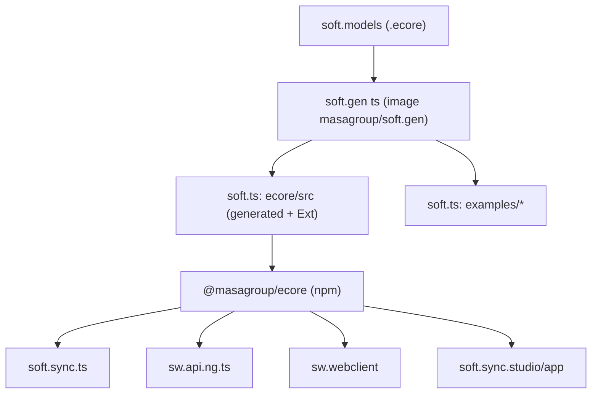
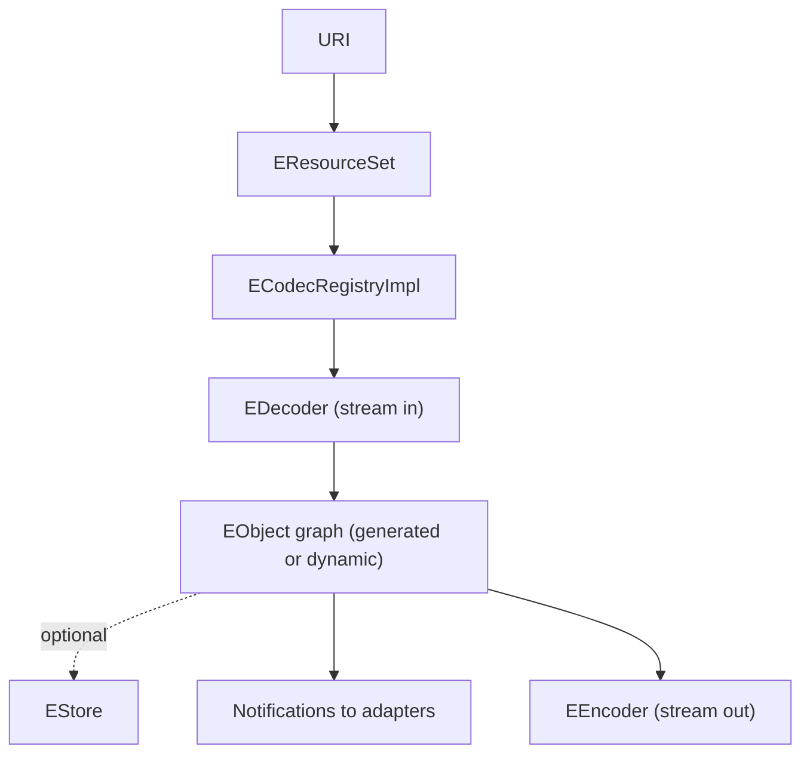
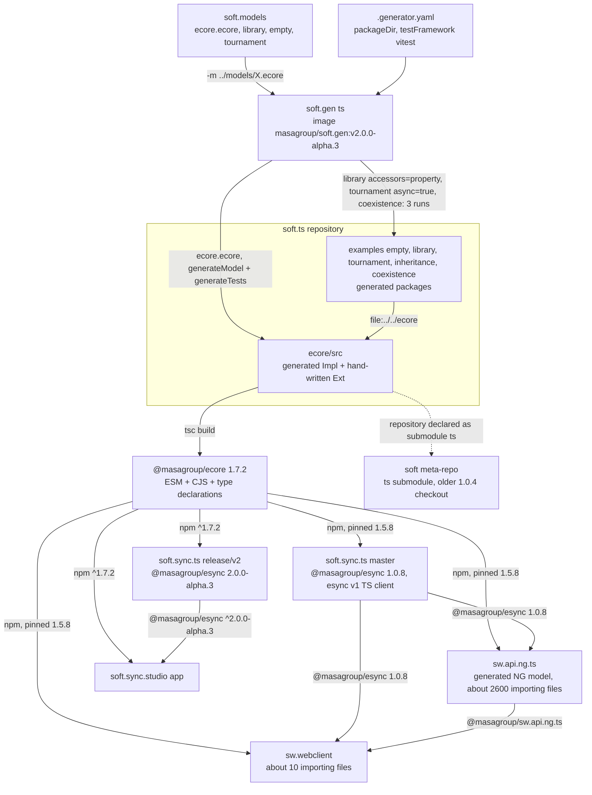
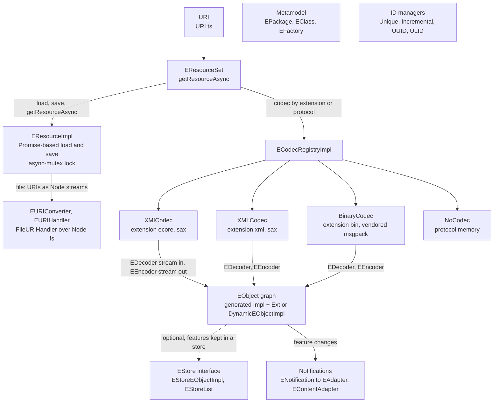
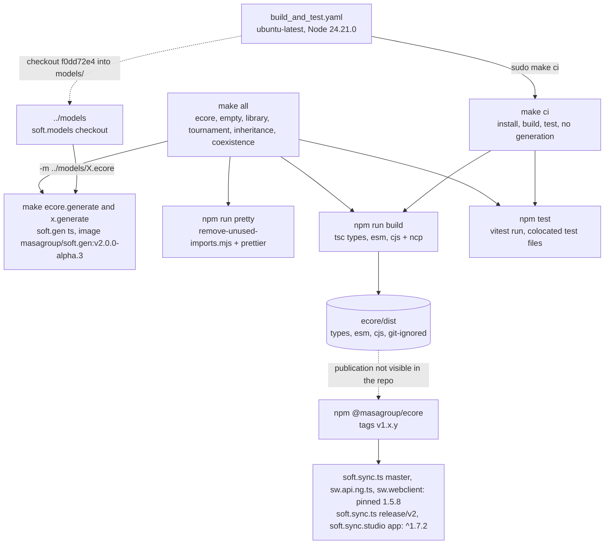

# soft.ts: architecture

> Technical choices, diagrams and internal structure of `soft.ts`. Back to the [README](README.md) · [Contributing](CONTRIBUTING.md) · [repository on GitHub](https://github.com/masagroup/soft.ts)

| | |
|---|---|
| **Family** | Ecore / esync stack |
| **Kind** | TypeScript library (plus generated example packages) |
| **Languages** | TypeScript (ES modules, target ES2020) |
| **Remote / branch** | github.com/masagroup/soft.ts, default branch `master` |
| **Generation** | shared (partially generated; consumed by next gen TypeScript code) |
| **Build systems** | npm (`ecore/package.json`) · GNU Make (root `Makefile`) · Docker only to run the code generator (image `masagroup/soft.gen:v2.0.0-alpha.3`) |

## Overview

The repository in its ecosystem (the text is in the [README](README.md#overview)):



## Position in the ecosystem

See the ecosystem wiki pages [Next generation ecosystem](https://github.com/masagroup/wiki/wiki/ecosystem-nextgen) and [esync and ecore](https://github.com/masagroup/wiki/wiki/esync-ecore).

| Concern | Status | Evidence |
|---|---|---|
| ecore model | Implements the TypeScript Ecore runtime (XMI/XML/binary codecs) | `ecore/src` |
| esync | Not in this repo; the TS esync library [soft.sync.ts](https://github.com/masagroup/soft.sync.ts) and `soft.sync.studio/app` depend on `@masagroup/ecore` (`soft.sync.ts`: 1.5.8 on `master`, `^1.7.2` on its `release/v2` branch; `soft.sync.studio/app`: `^1.7.2`) | `soft.sync.ts/package.json`, `soft.sync.studio/app/package.json` |
| storage | Partially related: provides the `EStore` abstraction (`EStore.ts`, `EStoreEObjectImpl.ts`, `EStoreList.ts`), no concrete backend, no link to a `storage` service | `ecore/src/EStore*.ts` |
| webclient | Consumer: [sw.webclient](https://github.com/masagroup/sw.webclient) depends on `@masagroup/ecore` 1.5.8 (~10 source files import it); the library is also browser-oriented (`path-browserify`, `DOM` lib) | `sw.webclient/package.json`, `tsconfig.json` |
| api.ng.ts | Consumer: [sw.api.ng.ts](https://github.com/masagroup/sw.api.ng.ts) (TypeScript code generated from the NG ecore model) depends on `@masagroup/ecore` 1.5.8 and imports it in ~2600 files | `sw.api.ng.ts/package.json` |
| gateway, history, dos, authentication, node, orchestrator, commander, hub, recorder, timeline, mapserver, datacore, dispatcher, HLA | Unrelated (no mention in code, build or CI) | repo-wide structure |

## Repository layout

```
soft.ts/
├── .github/workflows/     one workflow: build_and_test.yaml
├── ecore/                 the library (@masagroup/ecore)
│   ├── src/               ~151 non-test .ts files, each with a colocated *.test.ts
│   │   └── msgpack/       vendored MessagePack codec
│   ├── testdata/          sample .ecore, .xml, .bin files (library, orders, shop, tournament)
│   ├── scripts/           remove-unused-imports.mjs
│   ├── dist/              build output (git-ignored)
│   └── package.json, tsconfig*.json, vite.config.ts, package-cjs.json
├── examples/              generated packages: empty, library, tournament, inheritance, coexistence
├── .generator.yaml        options passed to the code generator (generator.properties up to v1.7.0)
├── Makefile               install / generate / format / build / test targets
├── README.md
└── LICENSE
```

There is no Dockerfile, no `build.xml`, no `CMakeLists.txt`, no `docker-compose.yaml`, no `.gitmodules` and no Go code in this repository.

## Architecture

Top-level pieces:

- `ecore/` the library. `src/` holds the code, `testdata/` the sample models and serialized files.
- `examples/{empty,library,tournament,inheritance,coexistence}` generated packages depending on `@masagroup/ecore` via `file:`, showing generated code: `*Package`, `*PackageImpl`, `*Factory`, `*FactoryImpl`, `*Impl` classes and `*.test.ts`. `tournament` is generated with `async=true`, `library` with `accessors=property`, `inheritance` from its own model, `coexistence` as one shared package with two implementations (see below). `library` also has a hand-written `WriterExt.ts` (the `*Ext` convention).

Main components in `ecore/src` (by file prefix):

| Area | Content |
|---|---|
| Metamodel | `E*` interfaces, `E*Impl` (generated) and `E*Ext` (hand-written operations): EObject, EClass, EAttribute, EReference, EPackage, EFactory, EEnum, EDataType, EAnnotation, EGenericType, ... |
| Notifications | ENotifier, ENotification, EAdapter, AbstractEAdapter, `EContentAdapter` (propagates adapters through containment), notification chains |
| Collections | EList, BasicEList, ImmutableEList, EMap, BasicEMap, BasicEObjectList/Map, `EStoreList` |
| Dynamic model | `DynamicEObjectImpl` (instances of EClasses without generated code) |
| Storage abstraction | `EStore` interface (get/set/add/remove/move/clear/size, roots, container per object and feature), `EStoreEObjectImpl`, `EStoreProvider` and `ECacheProvider` (both defined in `EStore.ts`). Objects read and write features through a store instead of their own fields. No concrete store implementation exists in this repo. Recent work (v1.6.0 / v1.6.1, PRs #67 "estore" and #68) targets this area |
| Resources | `EResource`, `EResourceImpl`, `EResourceSet(Impl)` with Promise-based `load` / `save` / `getResourceAsync`; `URI.ts`, `EURIConverter`, `EURIHandler`, `FileURIHandler`; package registry `EPackageRegistry` |
| Codecs | selected by `ECodecRegistryImpl` (extension map: `ecore` -> XMICodec, `xml` -> XMLCodec, `bin` -> BinaryCodec; protocol map: `memory` -> NoCodec). XML/XMI: `XMLEncoder/Decoder`, `XMIEncoder/Decoder` (sax-based). Binary: `BinaryEncoder/Decoder` on `msgpack/`, options `ID_ATTRIBUTE` and `CODEC_EXTENSION` (`BinaryCodec.ts`) |
| ID management | `EObjectIDManager`, `UniqueIDManager`, `IncrementalIDManager`, `UUIDManager`, `ULIDManager` |
| Utilities | `DeepCopy`, `DeepEqual`, `EcoreUtils`, `ExtendedMetaData`, `ETreeIterator`, `utils/Stream.ts`, `UTF8.ts`, `TypedArray.ts` |



Notable points:

- Generated code is checked in; `Impl` files are generated, `Ext` files hold the manual logic.
- `strict: false` in `tsconfig.json`.
- Dual-package emit (ESM + CJS + types) from three tsconfigs: `tsconfig.esm.json`, `tsconfig.cjs.json`, `tsconfig.types.json`.
- Cross-language compatibility of the binary format with soft.go / soft.cpp is not established here (UNVERIFIED).

### One shared package, several implementations

Generated with the property `packageInstance=interfaces` of soft.gen ts (soft.gen v2) and an implementation module distinct from the interface module (`packages=<nsURI>=<interfaces>#<implementation>`), the package of a metamodel (`getXPackage`) is generated once, with its interfaces (`-t generateInterfaces`), and shared by its implementations: each implementation (`-t generateImplementations`, one run each, with the path of the interfaces in the `paths` property) holds its classes and a factory of its own (`getFactory()`), whose package is the shared one. The objects of all implementations have the same `EClass`. The factory instance of the shared package only converts data types: its `create` throws. The example `examples/coexistence` generates a typed and a reflective implementation of the tournament model (see the `coexistence.generate` target of the Makefile).

The implementation a resource set creates its objects with (XML and binary loads) is the factory registered for the nsURI in its package registry:

```typescript
const typedSet = new EResourceSetImpl()
typed.install(typedSet.getPackageRegistry()) // registerPackage(getTournamentPackage()) + registerFactory(typed.getFactory())
const reflectiveSet = new EResourceSetImpl()
reflectiveSet.getPackageRegistry().registerPackage(getTournamentPackage())
reflectiveSet.getPackageRegistry().registerFactory(reflective.getFactory())
```

There is no global default implementation: each resource set chooses its implementation in its registry. `getFactory(nsURI)` of a registry returns the registered factory, else the factory instance of the package, else the one of its delegate.

`getObjectFactory(obj)` returns the factory of the implementation of an object: copies and the entries of maps are of the implementation of the object they come from. The objects of different implementations of a shared package do not mix: containing, referencing (lists, single references, `eSet`) or adding as a root of the same resource an object of another implementation throws (`checkSameImplementation`) once `setImplementationChecks(true)` is called, in tests or debug builds. The checks are off by default and then cost a boolean test. The property `checkImplementation=false` of soft.gen ts (soft.gen v2) leaves them out of the generated setters.

## How it works

soft.ts builds the npm library `@masagroup/ecore` (version 1.7.2, MPL-2.0), the TypeScript implementation of the EMF Ecore runtime ("Soft TS"), plus five generated example packages (`examples/empty`, `examples/library`, `examples/tournament`, `examples/inheritance`, `examples/coexistence`). Nothing runs on its own: there is no executable, no network code and no port, and the library executes inside the consumer process, where it loads and saves model graphs from URIs in XMI (`.ecore`), XML (`.xml`) or binary MessagePack (`.bin`) form. Part of its sources is generated: the Ecore models of soft.models go through `soft.gen ts` of soft.gen v2 (a Go tool that the Makefile runs from its Docker image `masagroup/soft.gen`), and the result is checked in under `ecore/src`. It is a shared brick of the Ecore / esync stack, the TypeScript sibling of soft.go and soft.cpp, consumed by next gen TypeScript code: soft.sync.ts (`@masagroup/esync`), sw.api.ng.ts and sw.webclient.

### Components and data flow



- Generation is a developer step driven by the root `Makefile`: `docker run --rm $(SOFT_GEN_USER) -v $(CURDIR):/soft/ts -v $(MODELS):/soft/models -w /soft/ts masagroup/soft.gen:v2.0.0-alpha.3 ts -m ../models/<model>.ecore -o ./<out> -P .generator.yaml <opts>`. Running it on `ecore.ecore` (Ecore itself) with `-t generateModel -t generateTests -p printWidth=140` regenerates the library's own metamodel classes and their tests in `ecore/src`; running it on `library.ecore`, `empty.ecore` and `tournament.ecore` produces the example packages, `inheritance` is generated from its own model `examples/inheritance/inheritance.ecore`, and `coexistence` from three generations of `tournament.ecore` (interfaces, typed and reflective implementations). Generated code is checked in: `Impl` files are generated and `Ext` files hold the manual logic (`examples/library` keeps a hand-written `WriterExt.ts`).
- The generator is not a dependency of the repository: the Makefile runs the image `SOFT_GEN_IMAGE` (`masagroup/soft.gen:$(SOFT_GEN_VERSION)`, `SOFT_GEN_VERSION` = `v2.0.0-alpha.3`), with the repository mounted on `/soft/ts` and `../models` on `/soft/models`, and stops with "../models not found" when that folder is missing; Go is not needed. Up to v1.7.0 it ran `go run github.com/masagroup/soft.gen/v2/cmd/soft-gen@v2.0.0-alpha.2` with `go`, else `go.exe`, else a golang container, and read `generator.properties`; the command is `cmd/soft.gen` from soft.gen v2.0.0-alpha.3 (see [soft.gen](https://github.com/masagroup/soft.gen)). A template change therefore ripples soft.gen -> runtimes such as soft.ts -> sw.api.ng.* -> their consumers.
- The library itself talks to nobody: no `bin` entry, no server, no CLI, no environment variable and no configuration file. Everything that reaches the network (esync over WebSocket, the gateway) lives in its consumers.
- soft.sync.ts (the TypeScript client of esync v1, no server), sw.api.ng.ts (TypeScript code generated from the NG ecore model) and sw.webclient all pin `@masagroup/ecore` 1.5.8 while this repository is at 1.7.2; why, and whether they need the 1.6.x or later EStore work, is UNVERIFIED. Only the v2 line requires `^1.7.2`: the `release/v2` branch of soft.sync.ts (`@masagroup/esync` 2.0.0-alpha.3, on `@masagroup/soft.sync.pb.ts` 2.x) and the soft.sync.studio `app`. In sw.api.ng.ts the Ecore package itself is mapped to `@masagroup/ecore` and `@masagroup/esync`, which makes every generated SWORD class a sync-aware object.
- The soft meta-repo declares this repository as its `ts` submodule, but the workspace checkout `soft/soft/ts` is an older one (package 1.0.4, layout `ecore`/`library`, no `examples/`). soft.sync.studio `app` used to build against that checkout through `file:../../soft/ts/ecore`; it now requires `@masagroup/ecore` `^1.7.2` from npm, with `@masagroup/esync` `^2.0.0-alpha.3`.

### Inside the ecore library



- `ecore/src` holds about 151 non-test files, each with a colocated `*.test.ts`. `index.ts` re-exports the public API (EObject, EClass, EPackage, EResource, EResourceSet, codecs, ID managers, EStore...), and every internal import goes through the `internal.ts` barrel, which controls the circular-import order (the generated examples use the same pattern). `tsconfig.json` has `strict: false`.
- Metamodel classes follow the `Impl` / `Ext` split (EObject, EClass, EAttribute, EReference, EPackage, EFactory, EEnum, EDataType, EAnnotation, EGenericType...); `DynamicEObjectImpl` instantiates an EClass that has no generated code. Multi-valued features use `EList`, `BasicEList`, `ImmutableEList`, `EMap`, `BasicEMap`, `BasicEObjectList/Map` or `EStoreList`.
- Loading and saving are asynchronous: `EResourceSet` and `EResource` expose Promise-based `load`, `save` and `getResourceAsync`, and `EResourceImpl` locks them with a `Mutex` from `async-mutex`. `FileURIHandler` (`file:` scheme over Node `fs`/`stream`) is the only OS-level interaction; `path-browserify` and the `DOM` lib keep the library usable in a browser.
- `ECodecRegistryImpl` picks the codec from the extension map (`ecore` -> `XMICodec`, `xml` -> `XMLCodec`, `bin` -> `BinaryCodec`) or the protocol map (`memory` -> `NoCodec`). XML and XMI parse with `sax`; the binary codec runs on the MessagePack code vendored in `src/msgpack/` (origin and licensing UNVERIFIED), with options `ID_ATTRIBUTE` and `CODEC_EXTENSION`; encoders and decoders return `Result` values from `ts-results-es`. Compatibility of the binary format with soft.go and soft.cpp is UNVERIFIED.
- Feature changes are sent as `ENotification`s to the object's `EAdapter`s (with notification chains), and `EContentAdapter` propagates an adapter through the containment tree. ID managers (`EObjectIDManager`, `UniqueIDManager` with UUID v4 / ULID from `id128`, `IncrementalIDManager`, `UUIDManager`, `ULIDManager`) identify objects; sw.webclient, for example, sets one on its `mem://simulation` resource.
- `EStore` (get, set, add, remove, move, clear, size, roots, container per object and feature) lets an `EStoreEObjectImpl` read and write its features through a store instead of its own fields; `EStoreProvider` and `ECacheProvider` are declared in `EStore.ts`. This is the area of v1.6.0 / v1.6.1 (PRs #67 "estore" and #68), but the repository ships no concrete store, and which next gen component provides or consumes one is UNVERIFIED.
- A metamodel can be generated as one shared package (generator property `packageInstance=interfaces`) with several implementations; `examples/coexistence` has a typed and a reflective implementation of the tournament model. Each implementation has a factory of its own (`getFactory()`), and each resource set chooses its implementation by registering that factory in its package registry; there is no global default, and objects of different implementations do not mix (checked once `setImplementationChecks(true)` is called, off by default).

### From sources to artifacts



- Only npm and a root GNU `Makefile` exist: no `build.xml`, no Dockerfile, no `docker-compose.yaml`, no CMake, no `go.mod`; Docker is only needed to run the generator (image `masagroup/soft.gen`), not for `make ci`, and Go is not needed at all. `make` and `npm` must be on the PATH (which `make` Windows developers use is UNVERIFIED), and generation expects the soft.models repository as a sibling named `models` while the reference workstation has `soft.models` (how the team handles it locally is UNVERIFIED).
- `make all` chains, for `ecore` and each example, `install generate format build test`; `make ci` skips generation and formatting; `make examples` is `library empty` only (`tournament`, `inheritance` and `coexistence` are left out). The examples consume the library through `file:../../ecore` and reuse `ecore/scripts/remove-unused-imports.mjs`, which strips unused import specifiers only (oxlint `no-unused-vars` in JSON mode).
- The artifact is `ecore/dist`, a dual package: the exports map sends `types` to `dist/types/index.d.ts`, `require` to `dist/cjs/index.js` (with a copied `{"type":"commonjs"}` package.json) and `import` to `dist/esm/index.js`; `engines.node` is `>= 16`.
- The single workflow (PR to `master`, push to `master`, `workflow_dispatch`) runs `sudo env "PATH=$PATH" make ci` and does not use the shared masagroup/cicd workflows. It has no publish step (no `npm publish`, release, artifact upload or Docker image): "build: set package version to X" commits and `v1.x.y` tags suggest a manual or external publication (UNVERIFIED), and the soft.models checkout appears unused by `make ci`, which never expands the generator command that checks `../models` (UNVERIFIED whether it is a leftover).

## Dependencies

### Internal (MASA repositories)

| Repository | How it is pulled | What for |
|---|---|---|
| [soft.models](https://github.com/masagroup/soft.models) | sibling folder `../models` (generation; mounted on `/soft/models` in the soft.gen container); CI checkout at commit `f0dd72e4ff1ff931f202c7464d30a15b4cf2102d` | Ecore models `ecore.ecore`, `library.ecore`, `empty.ecore`, `tournament.ecore` fed to the generator |
| [soft.gen](https://github.com/masagroup/soft.gen) (v2) | Docker image `masagroup/soft.gen:v2.0.0-alpha.3` in the `Makefile` (`SOFT_GEN_VERSION`, `SOFT_GEN_IMAGE`); `go run github.com/masagroup/soft.gen/v2/cmd/soft-gen@v2.0.0-alpha.2` up to v1.7.0 | Generates model classes in `ecore/src` and the `examples/*` packages |

No `<update>` / `<update-gh>` (no Ant), no `FROM masagroup/*` (no Dockerfile), no `go.mod` (soft.gen runs from its Docker image), no submodule. The shared `masagroup/cicd` workflows are not used.

Inbound (repositories that consume `@masagroup/ecore`):

| Consumer | How | Version |
|---|---|---|
| `examples/*` (this repo) | `file:../../ecore` | local |
| [soft.sync.ts](https://github.com/masagroup/soft.sync.ts) (`@masagroup/esync`) | npm, `package.json` line 62 (`master`, esync 1.x); line 52 on the `release/v2` branch (`@masagroup/esync` `2.0.0-alpha.3`) | `1.5.8` (`master`), `^1.7.2` (`release/v2`) |
| [sw.api.ng.ts](https://github.com/masagroup/sw.api.ng.ts) | npm, `package.json` line 80, ~2600 files import it | `1.5.8` |
| [sw.webclient](https://github.com/masagroup/sw.webclient) | npm, `package.json` line 46, ~10 files import it | `1.5.8` |
| [soft.sync.studio](https://github.com/masagroup/soft.sync.studio) (`app`) | npm, `app/package.json` line 14 (before: `file:../../soft/ts/ecore`, the `ts` submodule of the [soft](https://github.com/masagroup/soft) meta-repo, whose checkout is the older `1.0.4` one) | `^1.7.2` |

### External

Runtime (`ecore/package.json`):

| Package | Version | Use |
|---|---|---|
| `async-mutex` | `^0.5.0` | `Mutex` in `EResourceImpl.ts` for load/save locking |
| `id128` | `^1.6.6` | UUID v4 / ULID in `UniqueIDManager.ts`, `msgpack/ULID.ts` |
| `sax` | `^1.6.1` | XML parsing in `XMLDecoder.ts` |
| `ts-results-es` | `^7.1.0` | `Result` / `Ok` / `Err` in encoders and decoders |
| `path-browserify` | `^1.0.1` | browser-compatible path handling |
| `@types/path-browserify`, `@types/sax` | - | type declarations |

Dev: `typescript ^7.0.2`, `vitest ^5.0.4`, `@vitest/coverage-v8 ^5.0.4`, `prettier ^3.9.10`, `oxlint ^1.88.0`, `ts-mockito ^2.6.1`, `deep-equal ^2.2.3`, `tslib ^2.8.1`, `ncp ^2.0.0`.

Optional: `@rollup/rollup-linux-x64-gnu 4.64.6`, pinned in every `package.json`; the purpose is presumably a rollup/vitest Linux CI workaround (UNVERIFIED).

The MessagePack codec is vendored in `ecore/src/msgpack/` (Encoder, Decoder, Extension, Date/UUID/ULID extensions, Int helpers). Its naming resembles `@msgpack/msgpack` but no such npm dependency exists; the origin of the vendored code is UNVERIFIED.
