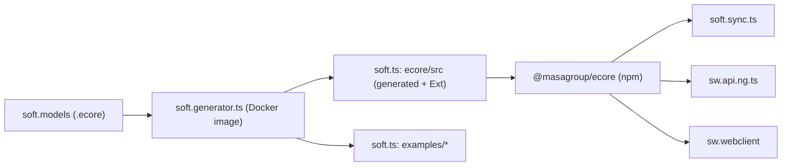

---
sword:
  schema: 1
  name: soft.ts
  family: ecore-esync
  kind: ts-lib
  generation: shared
  shipped: false # UNVERIFIED
  languages: [TypeScript]
  build: [npm, make, docker]
  ng: [ecore-model, storage, esync, webclient]
  apps: []
---

# soft.ts

[](https://github.com/masagroup/soft.ts/blob/master/LICENSE)


> TypeScript implementation of the EMF Ecore runtime (npm package `@masagroup/ecore`), the base library used by TypeScript code generated from the SWORD ecore models.

| | |
|---|---|
| **Family** | Ecore / esync stack |
| **Kind** | TypeScript library (plus generated example packages) |
| **Languages** | TypeScript (ES modules, target ES2020) |
| **Remote / branch** | github.com/masagroup/soft.ts, default branch `master` |
| **Generation** | shared (partially generated; consumed by next gen TypeScript code) |
| **Build systems** | npm (`ecore/package.json`) · GNU Make (root `Makefile`) · Docker only to run the code generator |

## Overview

Soft TS is the TypeScript member of the "Soft" family (soft.go, soft.cpp, soft.gen, soft.models). It provides the Ecore metamodel (EClass, EPackage, ...), dynamic and generated EObjects, notifications, resources and resource sets, XML/XMI/binary (msgpack) codecs, ID managers and an `EStore` abstraction. The README states that it "is partially generated and referenced by the Soft TS Generator" (`masagroup/soft.gen`), and that it is part of `masagroup/soft`.

It is a pure in-process library: no executable, no network code, no ports. Everything that talks to the outside is a consumer of this package.

- Version: `1.6.1` (latest tag `v1.6.1`), license MPL-2.0.
- Dual ESM + CJS package with generated type declarations.
- Consumers: the examples of this repo (`file:../../ecore`), [soft.sync.ts](https://github.com/masagroup/soft.sync.ts) (`@masagroup/esync`), [sw.api.ng.ts](https://github.com/masagroup/sw.api.ng.ts), [sw.webclient](https://github.com/masagroup/sw.webclient), and `soft.sync.studio/app` ([soft.sync.studio](https://github.com/masagroup/soft.sync.studio)).
- The meta-repo [soft](https://github.com/masagroup/soft) declares this repo as its `ts` submodule (`soft/.gitmodules`, url `https://github.com/masagroup/soft.ts.git`). The checkout of that submodule in the workspace is a separate, older checkout (package version `1.0.4`, layout `ecore`/`library`, no `examples/`).



## Repository layout

```
soft.ts/
├── .github/workflows/     one workflow: build_and_test.yaml
├── ecore/                 the library (@masagroup/ecore)
│   ├── src/               ~151 non-test .ts files, each with a colocated *.test.ts
│   │   └── msgpack/       vendored MessagePack codec
│   ├── testdata/          sample .ecore, .xml, .bin files (library, orders, shop, tournament)
│   ├── scripts/           remove-unused-imports.mjs
│   ├── dist/              build output (git-ignored)
│   └── package.json, tsconfig*.json, vite.config.ts, package-cjs.json
├── examples/              generated packages: empty, library, tournament
├── generator.properties   options passed to the code generator
├── Makefile               install / generate / format / build / test targets
├── README.md
└── LICENSE
```

There is no Dockerfile, no `build.xml`, no `CMakeLists.txt`, no `docker-compose.yaml`, no `.gitmodules` and no Go code in this repository.

## Build

Only the Node/npm toolchain and a root GNU `Makefile` are present.

### Toolchain

- Node 24.21.0 in CI (`.github/workflows/build_and_test.yaml`); `engines.node >= 16` in `ecore/package.json`.
- Dev dependencies: TypeScript `^7.0.2`, vitest `^5.0.4`, prettier `^3.9.10`, oxlint `^1.88.0`, ncp `^2.0.0`.
- `make` and `npm` must be on the PATH. UNVERIFIED which `make` implementation Windows developers use.

### Windows (Ant)

Not applicable (no `build.xml`).

### Linux (Docker)

Not applicable for the build. Docker is only used by the Makefile to run the generator image (see below).

### Other (npm, Make)

Commands to run from the repo root:

```
# CI-equivalent (install + build + test, no regeneration)
make ci
```

Library only:

```
cd ecore
npm install --no-fund --loglevel=error
npm run build
npm test
```

Regenerate the generated sources (needs Docker and the `soft.models` repo as `../models`):

```
make ecore.generate
```

npm scripts of `ecore/package.json`:

| Script | Command |
|---|---|
| `build` | `npm run build-types && npm run build-esm && npm run build-cjs` |
| `build-types` | `tsc -b tsconfig.types.json` (declarations into `dist/types`) |
| `build-esm` | `tsc -b tsconfig.esm.json` (into `dist/esm`) |
| `build-cjs` | `tsc -b tsconfig.cjs.json && ncp ./package-cjs.json ./dist/cjs/package.json` (CommonJS in `dist/cjs`, with a `{"type":"commonjs"}` package.json) |
| `pretty` | `node scripts/remove-unused-imports.mjs && prettier --write src/**/*.ts` |
| `lint` | `oxlint src` |
| `test` | `vitest run` (config `ecore/vite.config.ts`: include `src/**/*.test.ts`) |
| `test:coverage` | `vitest run --coverage` (`@vitest/coverage-v8`) |

`ecore/scripts/remove-unused-imports.mjs` runs oxlint (rule `no-unused-vars`) in JSON mode and strips only unused import specifiers (unlike `oxlint --fix`). The example packages reuse it through `../../ecore/scripts/remove-unused-imports.mjs`.

Exports map (`ecore/package.json`): `.` -> `types: dist/types/index.d.ts`, `require: dist/cjs/index.js`, `import: dist/esm/index.js`.

Root `Makefile` targets:

| Target | Chain / action |
|---|---|
| `all` | `ecore empty library tournament` (full regeneration + build + test) |
| `ci` | `ecore.ci empty.ci library.ci tournament.ci` (install + build + test, no generation) |
| `ecore` | `ecore.install ecore.generate ecore.format ecore.build ecore.test` |
| `ecore.ci` | `ecore.install ecore.build ecore.test` |
| `ecore.install` | `cd ecore && npm install --no-fund --loglevel=error` |
| `ecore.generate` | `docker run` of the generator on `ecore.ecore` with `-t generateModel -t generateTests` |
| `ecore.format` / `ecore.build` / `ecore.test` | `npm run pretty` / `build` / `test` in `ecore/` |
| `examples` | `library empty` (`tournament` is not part of `examples`) |
| `library`, `empty`, `tournament` | `<x>.install <x>.generate <x>.format <x>.build <x>.test` |
| `<x>.ci` | `<x>.install <x>.build <x>.test` |
| `<x>.generate` | generator on `library.ecore` (`-p accessors=property`), `empty.ecore` (no extra option), `tournament.ecore` (`-p async=true`), output to `examples/` |

Generator invocation (`Makefile`):

```
docker run --rm -v $(CURDIR):/pwd -v $(realpath ../models):/models -w /pwd masagroup/soft.generator.ts -m /models/<model>.ecore -o /pwd/<out> -P /pwd/generator.properties <opts>
```

- The `masagroup/soft.generator.ts` image is pulled from DockerHub, not built here.
- The Makefile expects the [soft.models](https://github.com/masagroup/soft.models) repo as a sibling directory named `models` (`../models`). On the reference workstation the sibling is named `soft.models`, so a `models` directory or link would be needed. UNVERIFIED how the team handles it locally.
- `generator.properties`: MPL 2.0 license header ("Copyright(c) 2024 MASA Group"), `packageDir = $1/src`, `testFramework = vitest`.

## Run

Not applicable: this is a library. There is no `bin` entry, no server, no CLI, no port, no environment variable and no configuration file read. The only OS-level interaction is Node file IO in `ecore/src/FileURIHandler.ts` (`file:` URIs through Node `fs`/`stream`).

Library entry point: `ecore/src/index.ts` re-exports the public API (EObject, EClass, EPackage, EResource, EResourceSet, codecs, ID managers, EStore, ...). All internal imports go through `ecore/src/internal.ts`, a barrel file that controls circular-import order (the generated examples use the same pattern). Usage from a consumer: `npm install @masagroup/ecore`.

## Dependencies

### Internal (MASA repositories)

| Repository | How it is pulled | What for |
|---|---|---|
| [soft.models](https://github.com/masagroup/soft.models) | Docker bind mount `../models` (generation); CI checkout at commit `f0dd72e4ff1ff931f202c7464d30a15b4cf2102d` | Ecore models `ecore.ecore`, `library.ecore`, `empty.ecore`, `tournament.ecore` fed to the generator |
| [soft.gen](https://github.com/masagroup/soft.gen) (image `masagroup/soft.generator.ts`) | `docker run` in the `Makefile` | Generates model classes in `ecore/src` and the `examples/*` packages |

No `<update>` / `<update-gh>` (no Ant), no `FROM masagroup/*` (no Dockerfile), no `go.mod`, no submodule. The shared `masagroup/cicd` workflows are not used.

Inbound (repositories that consume `@masagroup/ecore`):

| Consumer | How | Version |
|---|---|---|
| `examples/*` (this repo) | `file:../../ecore` | local |
| [soft.sync.ts](https://github.com/masagroup/soft.sync.ts) (`@masagroup/esync`) | npm, `package.json` line 62 | `1.5.8` |
| [sw.api.ng.ts](https://github.com/masagroup/sw.api.ng.ts) | npm, `package.json` line 80, ~2600 files import it | `1.5.8` |
| [sw.webclient](https://github.com/masagroup/sw.webclient) | npm, `package.json` line 46, ~10 files import it | `1.5.8` |
| [soft.sync.studio](https://github.com/masagroup/soft.sync.studio) (`app`) | `file:../../soft/ts/ecore` (the `ts` submodule of the [soft](https://github.com/masagroup/soft) meta-repo; the workspace checkout of that submodule is the older `1.0.4` one) | local |

### External

Runtime (`ecore/package.json`):

| Package | Version | Use |
|---|---|---|
| `async-mutex` | `^0.5.0` | `Mutex` in `EResourceImpl.ts` for load/save locking |
| `id128` | `^1.6.6` | UUID v4 / ULID in `UniqueIDManager.ts`, `msgpack/ULID.ts` |
| `sax` | `^1.6.1` | XML parsing in `XMLDecoder.ts` |
| `ts-results-es` | `^7.1.0` | `Result` / `Ok` / `Err` in encoders and decoders |
| `path-browserify` | `^1.0.1` | browser-compatible path handling |
| `@types/path-browserify`, `@types/sax` | - | type declarations |

Dev: `typescript ^7.0.2`, `vitest ^5.0.4`, `@vitest/coverage-v8 ^5.0.4`, `prettier ^3.9.10`, `oxlint ^1.88.0`, `ts-mockito ^2.6.1`, `deep-equal ^2.2.3`, `tslib ^2.8.1`, `ncp ^2.0.0`.

Optional: `@rollup/rollup-linux-x64-gnu 4.64.6`, pinned in every `package.json`; the purpose is presumably a rollup/vitest Linux CI workaround (UNVERIFIED).

The MessagePack codec is vendored in `ecore/src/msgpack/` (Encoder, Decoder, Extension, Date/UUID/ULID extensions, Int helpers). Its naming resembles `@msgpack/msgpack` but no such npm dependency exists; the origin of the vendored code is UNVERIFIED.

## Architecture

Top-level pieces:

- `ecore/` the library. `src/` holds the code, `testdata/` the sample models and serialized files.
- `examples/{empty,library,tournament}` generated packages depending on `@masagroup/ecore` via `file:`, showing generated code: `*Package`, `*PackageImpl`, `*Factory`, `*FactoryImpl`, `*Impl` classes and `*.test.ts`. `tournament` is generated with `async=true`, `library` with `accessors=property`. `library` also has a hand-written `WriterExt.ts` (the `*Ext` convention).

Main components in `ecore/src` (by file prefix):

| Area | Content |
|---|---|
| Metamodel | `E*` interfaces, `E*Impl` (generated) and `E*Ext` (hand-written operations): EObject, EClass, EAttribute, EReference, EPackage, EFactory, EEnum, EDataType, EAnnotation, EGenericType, ... |
| Notifications | ENotifier, ENotification, EAdapter, AbstractEAdapter, `EContentAdapter` (propagates adapters through containment), notification chains |
| Collections | EList, BasicEList, ImmutableEList, EMap, BasicEMap, BasicEObjectList/Map, `EStoreList` |
| Dynamic model | `DynamicEObjectImpl` (instances of EClasses without generated code) |
| Storage abstraction | `EStore` interface (get/set/add/remove/move/clear/size, roots, container per object and feature), `EStoreEObjectImpl`, `EStoreProvider` and `ECacheProvider` (both defined in `EStore.ts`). Objects read and write features through a store instead of their own fields. No concrete store implementation exists in this repo. Recent work (v1.6.0 / v1.6.1, PRs #67 "estore" and #68) targets this area |
| Resources | `EResource`, `EResourceImpl`, `EResourceSet(Impl)` with Promise-based `load` / `save` / `getResourceAsync`; `URI.ts`, `EURIConverter`, `EURIHandler`, `FileURIHandler`; package registry `EPackageRegistry` |
| Codecs | selected by `ECodecRegistryImpl` (extension map: `ecore` -> XMICodec, `xml` -> XMLCodec, `bin` -> BinaryCodec; protocol map: `memory` -> NoCodec). XML/XMI: `XMLEncoder/Decoder`, `XMIEncoder/Decoder` (sax-based). Binary: `BinaryEncoder/Decoder` on `msgpack/`, options `ID_ATTRIBUTE` and `CODEC_EXTENSION` (`BinaryCodec.ts`) |
| ID management | `EObjectIDManager`, `UniqueIDManager`, `IncrementalIDManager`, `UUIDManager`, `ULIDManager` |
| Utilities | `DeepCopy`, `DeepEqual`, `EcoreUtils`, `ExtendedMetaData`, `ETreeIterator`, `utils/Stream.ts`, `UTF8.ts`, `TypedArray.ts` |

```mermaid
flowchart LR
    uri["URI"] --> rs["EResourceSet"]
    rs --> reg["ECodecRegistryImpl"]
    reg --> dec["EDecoder (stream in)"]
    dec --> graph["EObject graph (generated or dynamic)"]
    graph -. "optional" .-> store["EStore"]
    graph --> notif["Notifications to adapters"]
    graph --> enc["EEncoder (stream out)"]
```

Notable points:

- Generated code is checked in; `Impl` files are generated, `Ext` files hold the manual logic.
- `strict: false` in `tsconfig.json`.
- Dual-package emit (ESM + CJS + types) from three tsconfigs: `tsconfig.esm.json`, `tsconfig.cjs.json`, `tsconfig.types.json`.
- Cross-language compatibility of the binary format with soft.go / soft.cpp is not established here (UNVERIFIED).

## CI/CD

| Workflow | Triggers | What it does |
|---|---|---|
| `.github/workflows/build_and_test.yaml` ("Build and Test") | PR to `master` (opened, synchronize, reopened, ready_for_review), push to `master`, `workflow_dispatch` | ubuntu-latest; setup-node 24.21.0; checkout of the repo into `ts/`; checkout of `masagroup/soft.models` at `f0dd72e4...` into `models/`; runs `sudo env "PATH=$PATH" make ci` in `ts/` |

- This workflow does NOT use the shared [cicd](https://github.com/masagroup/cicd) reusable workflows (outlier versus the convention described in the ecosystem wiki page "CI/CD pipelines").
- No publish step: no `npm publish`, no release, no artifact upload, no Docker image. How `@masagroup/ecore` reaches npm is not visible in this repo (UNVERIFIED; "build: set package version to X" commits and `v1.x.y` tags suggest a manual or external publication).
- `make ci` does not call the generator; the `soft.models` checkout therefore appears unused by it (UNVERIFIED whether it is a leftover or needed when the Makefile evaluates `$(realpath ../models)`).
- The README badge references `build_and_test.yaml` in `masagroup/soft.ts`.

## Next-gen relevance

See the ecosystem wiki pages "Next generation ecosystem" and "esync and ecore".

| Concern | Status | Evidence |
|---|---|---|
| ecore model | Implements the TypeScript Ecore runtime (XMI/XML/binary codecs) | `ecore/src` |
| esync | Not in this repo; the TS esync library [soft.sync.ts](https://github.com/masagroup/soft.sync.ts) and `soft.sync.studio/app` depend on `@masagroup/ecore` (1.5.8 and local `file:` respectively) | `soft.sync.ts/package.json`, `soft.sync.studio/app/package.json` |
| storage | Partially related: provides the `EStore` abstraction (`EStore.ts`, `EStoreEObjectImpl.ts`, `EStoreList.ts`), no concrete backend, no link to a `storage` service | `ecore/src/EStore*.ts` |
| webclient | Consumer: [sw.webclient](https://github.com/masagroup/sw.webclient) depends on `@masagroup/ecore` 1.5.8 (~10 source files import it); the library is also browser-oriented (`path-browserify`, `DOM` lib) | `sw.webclient/package.json`, `tsconfig.json` |
| api.ng.ts | Consumer: [sw.api.ng.ts](https://github.com/masagroup/sw.api.ng.ts) (TypeScript code generated from the NG ecore model) depends on `@masagroup/ecore` 1.5.8 and imports it in ~2600 files | `sw.api.ng.ts/package.json` |
| gateway, history, dos, authentication, node, orchestrator, commander, hub, recorder, timeline, mapserver, datacore, dispatcher, HLA | Unrelated (no mention in code, build or CI) | repo-wide structure |

## Known issues

No audit exists. `README.md` (about 12 lines) has no statement contradicting the code, but it does not describe: the Makefile workflow, the Docker-based generator, the `../models` expectation, the Node version, the EStore feature, the binary codec, or the examples. There is no CHANGELOG and no `docs/` folder.

Context: `soft.sync.ts`, `sw.api.ng.ts` and `sw.webclient` are all still on `@masagroup/ecore` 1.5.8 while this repo is at 1.6.1 (potential upgrade task, see open questions).

## Open questions

- UNVERIFIED: how and by whom `@masagroup/ecore` is published to npm (no publish workflow in the repo).
- UNVERIFIED: whether `../models` must be named `models` locally (Makefile) versus `soft.models` (actual sibling name on the reference workstation); `make ecore.generate` was not run.
- UNVERIFIED: whether any concrete `EStore` implementation exists in another repo, and which next-gen component consumes `EStoreEObjectImpl`.
- UNVERIFIED: binary (msgpack) format compatibility with soft.go / soft.cpp.
- UNVERIFIED: origin and licensing of the vendored `src/msgpack/` code.
- UNVERIFIED: why `soft.sync.ts`, `sw.api.ng.ts` and `sw.webclient` are all still on `@masagroup/ecore` 1.5.8 versus 1.6.1 here, and whether they need the 1.6.x EStore.
- UNVERIFIED: whether `soft.sync.studio/app` is intended to build against the older `1.0.4` checkout of the `ts` submodule rather than this repo (1.6.1).
- UNVERIFIED: which `make` implementation is used on Windows developer machines.
- UNVERIFIED: whether the `soft.models` checkout in CI is actually needed by `make ci`.
